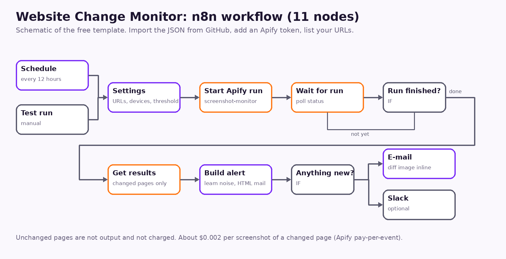
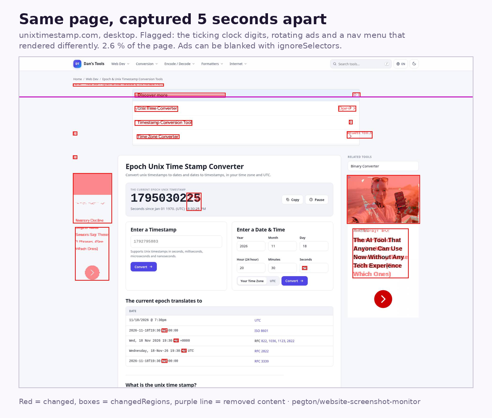

# Website Change Monitor for n8n (free workflow)

Every 12 hours this n8n workflow takes a full-page screenshot of each page you watch and compares it with the previous one. When a page really changed, you get one e-mail (or Slack message) with a diff image, changes in red.

**Good for:** competitor pricing pages, terms and policies, landing pages, your own site after deploys.

## Why another change monitor

Most screenshot diffs compare pixel by pixel. When a cookie notice, a sale banner or a longer headline pushes the page down by a few pixels, everything below counts as changed, and you get an alert every day. The screenshots here are compared by an Actor that aligns the rows first, so moved content is matched to its new position:

Measured on 18 Nov 2026: bbc.com with a 77 px banner inserted: 26.34 % changed pixel by pixel, 0.47 % with alignment. Notion pricing captured twice (layout moved 79 px): 5.05 % before, 0.53 % now.

On top of that, the **Build alert** node learns each page's usual noise (rotating teasers, counters) and only alerts above it.

## What you get

A real example: the same page captured 5 seconds apart. Only the clock digits, the rotating ads and one menu are flagged.

- Desktop, laptop, tablet and mobile in one run
- Cookie banners hidden with CSS (nothing is clicked or accepted), lazy images scrolled into view
- Watch only one block (`elementSelector`, e.g. `#pricing`) or blank noisy widgets (`hideSelectors`)
- Unchanged pages are not returned and not charged

## Setup (about 5 minutes)

1. Download [`website-change-monitor.json`](website-change-monitor.json). In n8n, go to **Workflows → Import from file**.
2. Create an Apify account. The free plan includes $5 credit per month. Copy your API token: Console → Settings → API & Integrations.
3. In n8n, create a **Header Auth** credential: name `Authorization`, value `Bearer YOUR_TOKEN`. Select it in **Start Apify run**, **Wait for run** and **Get results**.
4. In **Settings**, enter your URLs, devices, threshold and e-mail addresses.
5. Add an SMTP credential in **Send email alert**, or enable the Slack node.
6. Click **Test workflow**. The first run saves the reference screenshots and e-mails you the list of watched pages. Then activate the workflow.

## Cost

Screenshots come from [pegton/website-screenshot-monitor](https://apify.com/pegton/website-screenshot-monitor) on Apify: $0.002 per screenshot of a changed page, plus a tiny start fee per run. Unchanged pages cost nothing. Even if all 20 pages changed on every check, twice a day, that is 20 × 2 × 30 × $0.002 = $2.40 a month, inside the free $5 credit. `maxChargeUsd` in **Settings** caps each run.

Disclosure: I built and maintain that Actor. The workflow is MIT-licensed. If you prefer another screenshot service, swap the three HTTP nodes.

## Limitations

- Pages behind a login or bot protection are captured as a normal visitor sees them.
- A single edited word is a tiny share of a long page. For prices, use `elementSelector` so only that block is compared.
- Tested on n8n 2.48 (self-hosted). Uses only built-in nodes (Schedule, Set, HTTP Request, IF, Code, Send Email, Slack).

MIT licence.
